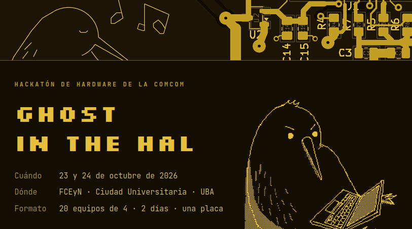
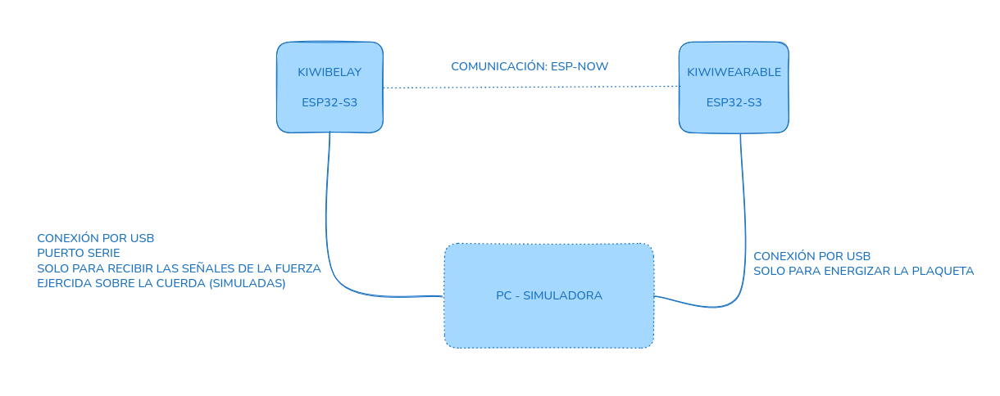

# Ghost In The Hal - Hackathon

Organizado por la Comisión de Estudiantes de Computación - FCEyN - UBA

[Sitio del Evento](https://web.archive.org/web/20261029000234/https://comcom.dc.uba.ar/hackaton/)

[Presentación](docs/presentacion.pdf)

## KiwiBelay

> Este repositorio mantiene una iteración sobre la entrega realizada para la hackathon. [Click acá](https://github.com/garciagomezluis/comcom-ghost-in-the-hal-esp32/releases/tag/0.0.1) para ver la versión entregada.

Prototipo de autobelayer portátil para escalada de primero. Un aparato que se ancla en la base de la vía, siente la tensión de la cuerda y decide en tiempo real si dar cuerda, recogerla, frenar una caída o bajar al escalador. El escalador lo controla desde la muñeca.

En este repositorio vas a encontrar:

1. Código para la placa 1: Placa controladora de la base (KiwiBelay)
2. Código para la placa 2: Placa controladora para la muñeca (KiwiWearable)
3. Código para la simulación: Representación de tensiones generadas sobre la cuerda (utilizado en la presentación).

### Arquitectura - Overview



1. Energizadas las dos plaquetas el escalador empieza a escalar
2. La cuerda es estirada, lo cual genera una fuerza (tensión simulada) registrada por la plaqueta de la KiwiBelay a través del puerto serie.
3. En base a la tensión registrada, KiwiBelay resuelve una máquina de estados que determina si entregar o no más cuerda (entre otras cosas).
4. Algunas acciones (como `descansar`) pueden ser disparadas desde el KiwiWearable. La señal es recibida a través de comunicación inalámbrica por KiwiBelay para resolver el siguiente estado de la máquina de estados y determinar si dar o no más cuerda.

> Es importante destacar que: Dada la fuerza ejercida sobre la cuerda y otras señales recibidas desde el KiwiWearable, KiwiBelay lo único que hace es resolver una máquina de estados determinando, entre otras cosas, si dar o no cuerda.

Para más detalles sobre la arquitectura, ver el [documento de arquitectura](docs/ARQUITECTURA.md).


## Estructura del repo

| Carpeta | Qué es |
|---|---|
| [`kiwibelay/`](kiwibelay/) | Firmware del KiwiBelay (ESP32-S3, ESP-IDF), con los tests del núcleo. |
| [`kiwiwearable/`](kiwiwearable/) | Firmware del KiwiWearable (ESP32-S3, ESP-IDF). |
| [`simulador/`](simulador/) | App web de simulación. |
| [`docs/`](docs/) | Documentación técnica. |

## Cómo usarlo

### Firmware (las dos placas)

Hace falta [ESP-IDF v6.1](https://docs.espressif.com/projects/esp-idf/en/latest/esp32s3/get-started/). Es probable que una configuración adicional sea necesaria dependiendo de tu sistema operativo y/o stack de trabajo.

```bash
> cd kiwibelay # o kiwiwearable
> idf.py set-target esp32s3
> idf.py -p /dev/ttyACM0 flash monitor
```

No activar la PSRAM: en estas placas choca con los pines del display (ver [notas de hardware](docs/ARQUITECTURA.md#9-notas-de-hardware)).

### Simulador

#### Instalación

> Si no tenés ganas de instalar las cosas, podés aprovechar la configuración de [devcontainers](https://containers.dev/) en el proyecto.

Hace falta Node.js 18 o más nuevo. Con el KiwiBelay conectado por USB, y `idf.py monitor` cerrado:

```bash
> /simulador$ npm install
```

#### Levantar el server

```bash
> /simulador$ npm start
```

Después se abre `http://localhost:3000`. El simulador busca la placa solo; para indicar el puerto a mano: `SERIAL_PATH=/dev/ttyACM0 npm start`.

#### Vista (sin tener las placas conectadas).


## Equipo: The Be Sharps

- **Augusto Mardones**: firmware del KiwiBelay.
- **Alexia Santos Canchanya Acosta**: firmware del KiwiWearable.
- **Luis García Gómez**: simulador.