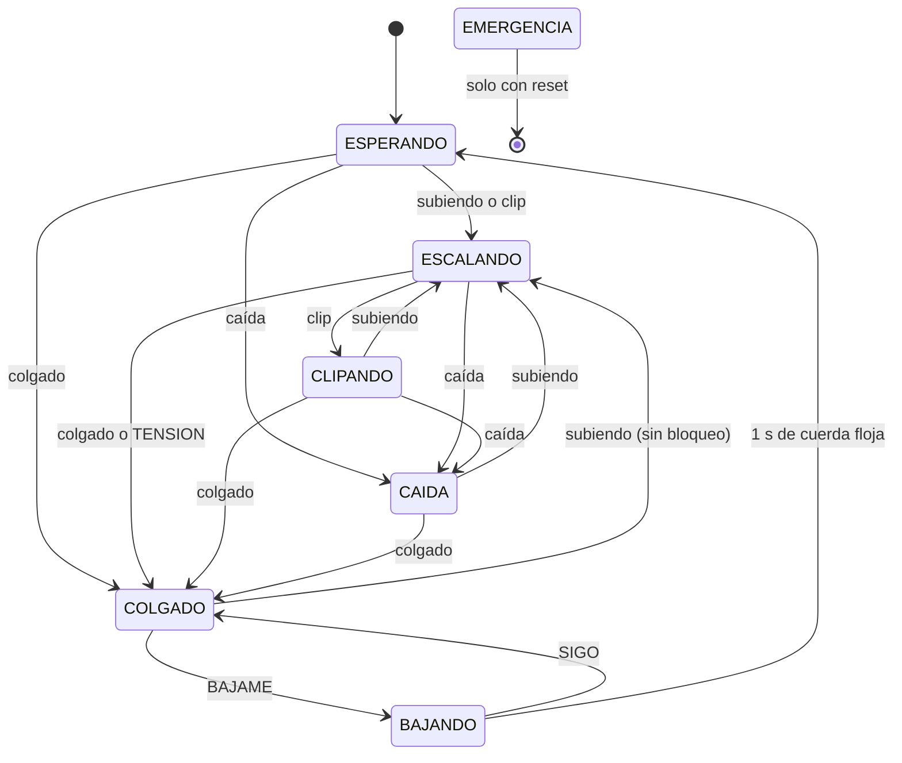

# Arquitectura de KiwiBelay

> [Documento original](https://github.com/AugusMardo/KiwiBelay/blob/main/docs/arquitectura.md) por Augusto. Esta versión no tiene tests por lo que no hay mención a ellos.

Este documento explica cómo funciona el sistema por dentro y por qué está hecho así. Para compilarlo y usarlo, ver el [README](../README.md).

## 1. Visión general

KiwiBelay es un prototipo de **autobelayer portátil para escalada de primero**: un aparato que se ancla en la base de la vía, da y recoge cuerda con un motor y frena cuando el escalador se cae. El sistema tiene tres piezas:

```
┌──────────────────────┐
│ Simulador (Node.js)  │  genera la tensión
└──────────────────────┘
     │            ▲
 T, R│            │@S, @E      USB serie
     ▼            │
┌──────────────────────┐
│ KiwiBelay (ESP32-S3) │  decide qué hacer
└──────────────────────┘
     ▲            │
     │comandos    │estado      ESP-NOW
     │            ▼
┌──────────────────────┐
│ KiwiWearable         │  control de muñeca
│ (ESP32-S3)           │  del escalador
└──────────────────────┘
```

- **Simulador** (`simulador/`): reemplaza al sensor de tensión (una celda de carga) que tendría el aparato real. Genera la tensión de la cuerda según lo que hace el escalador (subir, clipar, caerse, descansar, bajar) y se la manda al KiwiBelay 50 veces por segundo. También muestra lo que el KiwiBelay responde.
- **KiwiBelay** (`kiwibelay/`): el cerebro. Recibe **solo números de tensión**, deduce qué está pasando en la pared y decide qué haría el motor. Como no hay motor real, la decisión se muestra en su pantalla y se informa al simulador.
- **KiwiWearable** (`kiwiwearable/`): el control que lleva el escalador en la muñeca. Tiene cuatro botones para pedir cosas (tensión, bajar, seguir, ayuda) y una pantalla que muestra lo que está haciendo el KiwiBelay.

**Regla de diseño:** el simulador nunca le dice al KiwiBelay "el escalador se cayó". Le manda kilogramos-fuerza, y el KiwiBelay lo tiene que deducir solo, igual que con un sensor real.

## 2. El problema y el criterio de diseño

Un autobelayer tiene que decidir en todo momento qué hace con la cuerda:

- **Dar cuerda** mientras el escalador sube.
- **Recoger** la cuerda floja (por ejemplo, justo después de clipar).
- **Frenar** si se cae, y sostenerlo mientras está colgado.
- **Bajarlo** cuando lo pide.

Equivocarse no cuesta lo mismo en todos los casos: frenar sin necesidad es una molestia, pero no frenar en una caída es grave. Por eso todo el sistema sigue un criterio: **ante la duda, frena**. Este criterio aparece en el orden de la detección (la caída gana sobre cualquier otra lectura) y en la máquina de estados (se puede frenar desde cualquier estado, incluso si el sistema no había detectado que alguien estaba escalando).

Otros dos diferenciales del diseño:

- **No te baja solo.** Los autobelays de gimnasio bajan al escalador apenas carga la cuerda. Acá, después de una caída el escalador queda colgado hasta que pide bajar.
- **Emergencia automática.** Si después de una caída el escalador no da señales durante 15 segundos, el sistema entra en emergencia.

## 3. Detección: qué pasa en la pared

El KiwiBelay guarda las **últimas 50 muestras de tensión** (1 segundo a 50 Hz) en un buffer circular, la *ventana*. La ventana arranca llena de ceros (cuerda sin tensión), así que no hay un caso especial para el primer segundo.

De la ventana se calculan dos valores:

- **Pico:** la tensión máxima del último segundo. Sirve para eventos cortos (un tirón de clip, el impacto de una caída).
- **Promedio:** la tensión media del último segundo. Sirve para situaciones sostenidas (subir, estar colgado).

Con esos dos valores, `ab_inferir` clasifica lo que pasa en uno de cinco **contextos**. Las reglas se evalúan en este orden y gana la primera que se cumple, de la más peligrosa a la menos:

| # | Contexto | Regla | Umbral (escalador de 70 kg) |
|---|---|---|---|
| 1 | **Caída** | pico > 1,5 × peso × fricción | > 68,25 kgf |
| 2 | **Colgado** | promedio > 20 kgf | > 20 kgf |
| 3 | **Clip** | pico entre 10 y 15 kgf | 10 – 15 kgf |
| 4 | **Subiendo** | promedio entre 2 y 5 kgf | 2 – 5 kgf |
| 5 | **Sin carga** | ninguna de las anteriores | — |

**De dónde salen los números:**

- **Colgado ≈ 45,5 kgf.** Un escalador de 70 kg colgado no tira de la cuerda con sus 70 kg: parte de la carga se la llevan el roce de la cuerda en las chapas y la roca. Usamos una fricción constante de 0,65, así que colgado tira 70 × 0,65 = 45,5 kgf.
- **Caída > 1,5 veces la carga de colgado.** El impacto de una caída tira mucho más fuerte que estar colgado quieto (entre 70 y 160 kgf según la caída). No hace falta calcular el factor de caída: alcanza con que el pico sea claramente mayor que cualquier situación normal (clip 10–15, colgado ~45).
- **Colgado por promedio, no por pico.** Una carga grande y sostenida durante un segundo es alguien colgado. Este umbral no depende de la fricción.
- **Clip y subida.** Al subir, la cuerda tiene poca tensión (2–5 kgf). Al clipar, el escalador tira de la cuerda para pasarla por el mosquetón, lo que da un tirón corto de 10–15 kgf.

Todos los umbrales son constantes con nombre en `kiwibelay/main/autobelayer.h`.

**Por qué 1 segundo de ventana.** La ventana es la memoria de corto plazo ("qué hace la cuerda ahora"). Lo de largo plazo (cuánto hace que se cayó, si respondió después) lo recuerda la máquina de estados con marcas de tiempo. Un segundo alcanza para distinguir un tirón de una carga sostenida y deja una latencia baja: en los tests, el freno se activa en la misma muestra en la que llega el pico de la caída.

## 4. Máquina de estados

El KiwiBelay está siempre en uno de siete estados. En cada muestra, `ab_paso` actualiza la ventana, calcula el contexto y decide si cambia de estado.



**Transiciones:**

| Estado | Si... | Pasa a |
|---|---|---|
| ESPERANDO | contexto caída | CAÍDA |
| | contexto colgado | COLGADO |
| | contexto subiendo o clip | ESCALANDO |
| ESCALANDO | contexto caída | CAÍDA |
| | contexto clip | CLIPANDO |
| | contexto colgado | COLGADO |
| | comando TENSION | COLGADO, con bloqueo |
| CLIPANDO | contexto caída | CAÍDA |
| | contexto subiendo | ESCALANDO |
| | contexto colgado | COLGADO |
| CAÍDA | contexto colgado (el pico ya salió de la ventana) | COLGADO |
| | contexto subiendo | ESCALANDO |
| COLGADO | comando BAJAME | BAJANDO (quita el bloqueo) |
| | comando SIGO | se queda en COLGADO, pero quita el bloqueo |
| | contexto subiendo y sin bloqueo | ESCALANDO |
| BAJANDO | comando SIGO | COLGADO (cancela la bajada) |
| | pico de la ventana < 0,5 kgf (1 s entero con la cuerda floja) | ESPERANDO |
| EMERGENCIA | solo se sale con un reset | — |

**Emergencia.** Se evalúa antes que las demás transiciones, en cada muestra y desde cualquier estado. Se entra si:

- el escalador aprieta AYUDA;
- después de una caída pasan 15 segundos sin ninguna señal del escalador (cualquier comando, o volver a escalar, cuenta como señal);
- se corta el enlace con el wearable mientras hay carga en la cuerda (ver [limitaciones](#11-limitaciones-conocidas-y-próximos-pasos)).

**Qué hace el motor en cada estado:**

| Estado | Motor |
|---|---|
| ESPERANDO | QUIETO |
| ESCALANDO, CLIPANDO | RECOGE si la tensión de ahora es < 0,5 kgf (cuerda floja); si no, DA |
| CAÍDA, COLGADO, EMERGENCIA | FRENA |
| BAJANDO | BAJA |

**Decisiones finas:**

- **Recoger según la tensión de ahora, no según la ventana.** La ventana va un segundo atrasada: después de un clip, el pico sigue en la ventana aunque la cuerda ya esté floja. Para decidir si recoger se usa la última muestra.
- **Escalando, la cuerda floja no cambia el estado.** El arranque de una caída es cuerda floja (el escalador va cayendo). Si la floja devolviera el estado a ESPERANDO, se perdería la caída.
- **El bloqueo de TENSION.** TENSION significa "bloqueame que quiero descansar". Sin el bloqueo, el sistema volvería a ESCALANDO apenas viera una tensión de subida, antes de que el escalador cargue la cuerda. El bloqueo se quita con SIGO o BAJAME.
- **De COLGADO a ESCALANDO solo cuando baja la tensión.** Si SIGO cambiara el estado con el escalador todavía colgado, el motor pasaría a dar cuerda con carga.
- **Llegar al piso pide 1 segundo de cuerda floja.** Al tocar el piso la tensión cae a 0, pero la ventana todavía tiene la bajada adentro. Mientras esos restos salen, el promedio y el pico pasan por los rangos de "subiendo" y "clip". Si BAJANDO pasara a ESPERANDO con la primera lectura sin carga, desde ahí saltaría a ESCALANDO o CLIPANDO. Esperar a que la ventana esté entera floja evita la confusión.
- **Frenar desde ESPERANDO.** Si el sistema arranca con alguien ya colgado, o no detectó la subida, igual frena ante una caída o una carga de colgado.

## 5. Comandos del escalador

El escalador manda comandos desde el KiwiWearable (botones KEY1 a KEY4). El KiwiBelay también acepta los mismos comandos desde sus propios botones, como respaldo.

| Botón | Comando | Qué hace |
|---|---|---|
| KEY1 | TENSION | Escalando: pasa a COLGADO y queda bloqueado para descansar. |
| KEY2 | BAJAME | Colgado: empieza a bajarlo. |
| KEY3 | SIGO | Colgado: quita el bloqueo, y vuelve a ESCALANDO cuando la tensión es de subida. Bajando: cancela la bajada. |
| KEY4 | AYUDA | Desde cualquier estado: EMERGENCIA. |

Un comando que no corresponde al estado actual se ignora, pero igual cuenta como señal de vida del escalador.

## 6. El firmware del KiwiBelay por dentro

```
kiwibelay/main/
├── autobelayer.c/.h   núcleo (C puro)
├── main.c             integración: serie, radio, pantalla
├── radio.c/.h         ESP-NOW
├── protocol.h         mensajes con el wearable
├── display.c/.h       config. del display SSD1306
├── buttons.c/.h       config. de los botones
└── board.h            pines de la placa
```

**El núcleo está en C puro, sin ESP-IDF.** `autobelayer.c` tiene la ventana, la detección y la máquina de estados, y no sabe nada de la placa: recibe una muestra (tensión, tiempo, comando) y devuelve una salida (estado, motor, último comando, evento). Por eso se puede probar en la computadora con gcc, sin placa.

**Dos tareas de FreeRTOS:**

- **Lectura serie** (`serial_task`): usa el driver de USB Serial/JTAG con interrupciones, junta los bytes hasta formar una línea e interpreta cada una (`procesar_linea`). Cada muestra `T` es un paso de la máquina de estados: esta tarea es **la única dueña del núcleo**.
- **Bucle principal** (`app_main`): cada 50 ms lee los botones y los mensajes de radio, le manda el estado al wearable y redibuja la pantalla. Es **la única dueña de la pantalla**.

**Cómo se comunican las dos tareas:**

- **Comandos → núcleo:** los botones del KiwiBelay y los mensajes del wearable entran a una misma **cola de FreeRTOS**. En cada muestra, la tarea de lectura saca, como mucho, un comando de la cola y lo pasa al núcleo.
- **Núcleo → pantalla y radio:** la tarea de lectura copia el resultado (estado, motor, último comando, tensión) en variables compartidas que el bucle principal solo lee.

**El tiempo es el de la simulación.** El núcleo mide el tiempo como `seq × 20 ms`, a partir del número de muestra que manda el simulador, y no con el reloj de la placa. Así, si se pierde una muestra, el tiempo igual avanza bien, y el comportamiento en la placa es el mismo que en los tests.

**La pantalla** muestra el estado (que parpadea en CAÍDA y EMERGENCIA), la tensión con una barra de 0 a 100 kgf, la acción del motor, el último comando y la cantidad de muestras perdidas. Si pasa un segundo sin datos del simulador, muestra `ESPERANDO DATOS...`.

## 7. Protocolo simulador ↔ KiwiBelay

Texto ASCII, una línea por mensaje, terminada en `\n`, por el USB del ESP32-S3. Los campos van separados por un espacio y los decimales con punto.

**Del simulador al KiwiBelay:**

| Línea | Significado | Ejemplo |
|---|---|---|
| `T <seq> <kgf>` | Muestra de tensión, 50 por segundo. `seq` sube de a 1 y sirve para detectar muestras perdidas. | `T 1532 3.40` |
| `R` | Reset: el KiwiBelay vuelve al estado inicial. | `R` |

**Del KiwiBelay al simulador:**

| Línea | Significado | Ejemplo |
|---|---|---|
| `@S <estado> <motor> <ultimo_cmd>` | Estado completo. Se manda en cada cambio y cada 5 muestras (100 ms). | `@S COLGADO FRENA TENSION` |
| `@E <evento> [info]` | Evento puntual, se manda una sola vez. | `@E CAIDA pico=136.5` |

- Valores de `estado`: ESPERANDO, ESCALANDO, CLIPANDO, CAIDA, COLGADO, BAJANDO, EMERGENCIA.
- Valores de `motor`: QUIETO, RECOGE, DA, FRENA, BAJA.
- Valores de `ultimo_cmd`: NINGUNO, TENSION, BAJAME, SIGO, AYUDA.
- Eventos: CAIDA (con el pico) y EMERGENCIA.
- Todo lo que no empieza con `@` son logs del firmware, y el simulador los ignora.

**Estado y evento son cosas distintas.** El estado dura y se repite: si se pierde una línea `@S`, la siguiente corrige. El evento ocurre una vez y se manda una vez, y puede llevar datos (como el pico de la caída).

**Por qué texto.** Se puede probar a mano escribiendo líneas en `idf.py monitor`, se separa fácil de los logs (que también son texto) y el volumen es mínimo (unos 600 bytes por segundo).

## 8. Protocolo KiwiBelay ↔ KiwiWearable

Las dos placas se hablan por **ESP-NOW**, la radio punto a punto del ESP32, en el canal 1 de Wi-Fi y por broadcast. Cada placa acepta solo los mensajes que vienen de la dirección MAC de la otra, porque otros equipos pueden estar usando ESP-NOW en el mismo canal.

Los mensajes son structs empaquetados (`packed`), definidos en `protocol.h`. Se distinguen por el tamaño:

**`CommandMessage`** (6 bytes), del wearable al KiwiBelay, uno por cada botón apretado:

| Campo | Tipo | Contenido |
|---|---|---|
| `senderId` | u8 | identificador del wearable |
| `commandType` | u8 | 1 = TENSION, 2 = BAJAME, 3 = SIGO, 4 = AYUDA |
| `timestamp` | u32 | milisegundos desde que arrancó el wearable |

**`StatusMessage`** (29 bytes), del KiwiBelay al wearable, cada 200 ms:

| Campo | Tipo | Contenido |
|---|---|---|
| `statusText` | char[24] | texto listo para mostrar: el nombre del estado, `TE TENGO` en lugar de COLGADO, o `SIN DATOS` si el KiwiBelay no recibe tensión |
| `tensionReading` | float | tensión actual en kgf |
| `eventFlag` | u8 | 1 (alerta) en CAÍDA y EMERGENCIA, 0 en el resto |

- **El wearable no decide nada sobre el estado:** muestra el texto que recibe. Con la alerta cambia a una pantalla especial.
- **La confirmación de un comando es el estado que vuelve.** El comando se manda una sola vez. Si se pierde, el escalador ve que el estado no cambió y vuelve a apretar.
- **Si pasa un segundo sin `StatusMessage`**, el wearable muestra `SIN BASE`.
- El wearable además muestra animaciones al apretar BAJAME, SIGO y AYUDA.

**Para usar otras placas:** las direcciones MAC están fijas en el código. En el KiwiBelay es `MAC_PLACA_B` en `kiwibelay/main/main.c`, y en el wearable es `s_ground_mac` en `wearable/main/main.c`. Cada placa imprime su propia MAC en el log al arrancar.

## 9. Notas de hardware

Las dos placas son ESP32-S3 (chip ESP32-S3R8, flash de 16 MB) con un display OLED SSD1306 de 128×64, cuatro botones (KEY1 a KEY4) y un joystick.

- **La PSRAM tiene que estar apagada.** El chip trae 8 MB de PSRAM octal que usa los pines GPIO 33 a 37, y el display está conectado a los pines 36 y 37. Con la PSRAM activada, la placa se reinicia en loop apenas inicializa el display. Sin PSRAM quedan unos 300 KB de RAM libres con Wi-Fi, que sobran.
- **El USB es nativo** (USB Serial/JTAG): la placa aparece como `/dev/ttyACM0` en Linux. Por el mismo cable se flashea, se ven los logs y se comunica con el simulador, así que no se puede tener abierto `idf.py monitor` mientras corre el simulador.

## 10. Limitaciones conocidas y próximos pasos

- **La tensión es simulada.** No hay celda de carga ni motor reales: el sistema decide qué haría el motor, pero no lo mueve. En un aparato real, además, el freno sería mecánico (tipo grigri), para que frene aunque el software falle.
- **Peso fijo en 70 kg.** El umbral de caída depende del peso, y los umbrales están pensados para un escalador de alrededor de 70 kg. Para otro peso hay que ajustar `AB_PESO_DEFAULT_KG`. La mejora natural es **autocalibrar**: medir la tensión real la primera vez que el escalador queda colgado quieto.
- **Fricción constante.** En la realidad varía con las chapas, los ángulos y el roce con la roca. Solo afecta al umbral de caída, que tiene mucho margen.
- **Sin heartbeat del wearable.** El wearable solo transmite al apretar un botón, así que el KiwiBelay no puede saber si el enlace está vivo, y la regla de emergencia por enlace caído está inactiva (`enlace_vivo` vale siempre `true`). Con un mensaje periódico del wearable se activaría sin cambiar el resto.
- **Comandos sin reenvío.** Un comando se manda una sola vez y se confirma viendo el estado. Un ACK con reenvío automático lo haría más robusto.
- **Un pico suelto en el piso.** Desde ESPERANDO, una sola muestra de 10 a 15 kgf se toma como un clip y pasa a ESCALANDO. Sería más robusto pedir una subida sostenida para salir de ESPERANDO.
- **15 segundos sin respuesta** puede ser poco para alguien que descansa colgado sin apretar nada.
